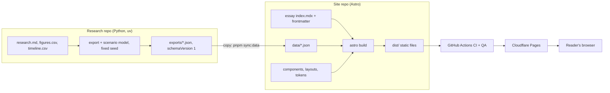

# PEIRA developer guide

How PEIRA works, how to use it, and how to develop it further without needing anyone's help.

Written November 2026 at the `v0.9.0` foundation freeze. Read this first, then use the other documents as reference.

## 0. How to read the documentation

| Document | What it is | When to read it |
|---|---|---|
| **This guide** | The mental model, the "why", how to extend the site, how the agent workflow works | First, and whenever you feel lost |
| `docs/PROJECT-STATE.md` | The verified reference: every file, route, component, script, setting, with evidence tags | When you need an exact fact |
| `docs/AUTHOR-HANDBOOK.md` | Day-to-day operation as author: new essay, write, check, publish | Every time you write |
| `docs/research-repo-STATE.md` | Snapshot of the research repo's state | When you touch the research side |
| `docs/sprint-0/` | Your original vision, requirements, decisions (ADRs), backlog | When you ask "why did we decide that?" |
| `docs/adr/` | Decisions made during the build (for example ADR-013) | Before changing a library or structure |
| `AGENTS.md` and `.github/skills/`, `.agents/skills/` | Instructions the coding agents obey | Before running an agent |

**Where this guide and `PROJECT-STATE.md` disagree, `PROJECT-STATE.md` wins.** It was checked against the code at the freeze. This guide was written from the design and the build history. It explains concepts and intent, and it was not checked line by line against the code. Section 11 shows how to check any statement here yourself.

## 1. The mental model

Six ideas explain almost everything about PEIRA.

### 1.1 PEIRA is a static site

A static site is built once into plain HTML, CSS and JavaScript files. A server just hands those files to readers. There is no database, no backend, and no code running on a server when someone opens a page.

- **Build time** is when your computer or CI turns source files (essays, components, data) into the final site (`pnpm build` writes `dist/`).
- **Run time** is when a reader opens a page. Their browser only displays what was already built.

Why this matters to you: hosting is free and fast, there is almost nothing to attack, and the site keeps working for years with no maintenance. The cost is that anything dynamic (comments, accounts, search) needs extra design. Your scope doc deliberately left those out of V1.

### 1.2 Content is files

An essay is a folder:

```
src/content/essays/<slug>/
  index.mdx     the essay: frontmatter (metadata) + text + components
  data/         JSON files the interactive modules render
  images/       local images
```

**MDX** is Markdown that can also contain components. That is how an essay embeds a map with one line.

**Frontmatter** is the block at the top of `index.mdx` between `---` lines. It holds title, dates, topics, sources, the research repo link, the Lab panel fields, and so on.

### 1.3 A schema guards the content

A schema is a set of rules about what frontmatter must look like. PEIRA uses **Zod** for this, wired in through Astro's **content collections**. At build time every essay is checked. If an essay has no sources, no image credit, no licence, no lens, no research repo URL, or no limitations note, the build fails with a message naming the field.

This is the point. Your editorial charter (sources, repo link, limitations, credits) is enforced by the build instead of by willpower.

Two related mechanisms:

- **Drafts.** An essay with `draft: true` is validated but never published. In `pnpm dev` you see drafts. In the production build they don't exist.
- **The placeholder guard.** A published essay (`draft: false`) containing `AUTHOR:`, `FILL_ME` or `AUTHOR-REPLACE` fails CI. It stops scaffold text from reaching readers.

### 1.4 Heavy analysis happens elsewhere

Machine learning and analysis do not run on the site. They run in a **research repo** (Python, managed with `uv`) that produces versioned JSON files. The site copies those files in and only draws them.

```
research repo (Python)  ->  exports/*.json  ->  site: essay data/  ->  module renders it
```

Why: the site stays static and free, the analysis is reproducible (fixed seeds, pinned environment, byte-identical re-runs), and a reader can follow a link from the essay to the exact code and data.

JSON files carry a `schemaVersion`. Each module has a schema for the data it accepts. A malformed data file fails the build naming the file. That is the **module contract**.

### 1.5 Interactivity comes in islands

Most of every page is plain HTML with no JavaScript. An interactive module (the map) is a small React component, called an **island**, that loads and activates only when it scrolls into view (`client:visible`). Everything else ships zero JavaScript.

Every module also has a **fallback**: a text or table version of the same data, always present on the page. It makes the site usable without JavaScript, readable by screen readers, and printable. The map module also keeps showing its points if the map tiles fail to load.

### 1.6 Automation checks everything

Every change goes through this path:

```
branch -> commit (hooks check the message and lint) -> push -> pull request
  -> CI: lint, type check, tests, build (and QA: browser tests, accessibility, Lighthouse)
  -> preview URL on Cloudflare -> merge to main -> production deploy
```

`main` is protected: it requires the `CI` check to pass. Nothing reaches the live site without passing the checks.

## 2. End to end: from idea to reader



The author's route, in plain steps: create an essay folder, write, run the checks, preview on a phone, open a pull request, merge, and it is live. `docs/AUTHOR-HANDBOOK.md` has the exact commands.

## 3. The layers of the repo

Names below come from the design. Confirm exact paths in `docs/PROJECT-STATE.md` section 4.

| Layer | What lives there | Why it exists |
|---|---|---|
| Content | `src/content/essays/<slug>/` | The essays and their data and images |
| Schema and logic | `src/content.config.ts`, `src/lib/` | Rules for essays; pure functions (sorting, filtering, reading time, module data loading). Pure functions are easy to test |
| Components | `src/components/` (including module components) | Reusable pieces: `Figure`, Lab panel, corrections, module frame, map |
| Pages and layouts | `src/pages/`, `src/layouts/` | The routes: home, essay, archive, topics, Lab, About |
| Styles | `src/styles/tokens.css` | The design tokens: every colour, font size and spacing value, as CSS variables |
| Demo data | `src/data/demo/` | Synthetic data for the Lab page, always labelled as demo |
| Scripts | `scripts/` | Author tooling and guards: new essay, status, sync data, placeholder and colour checks |
| Tests | `tests/` | Unit tests (Vitest), fixtures of deliberately broken content, browser tests (Playwright + axe) |
| Automation | `.github/workflows/` | CI, QA and deploy |
| Container | `Dockerfile` | Builds the site and serves it with nginx, so you can host it anywhere |
| Docs | `docs/` | Everything in section 0 |
| Agent config | `AGENTS.md`, `.github/skills/`, `.agents/skills/`, `prompts/` | How coding agents are told to work (section 7) |

Rules the structure enforces:

- Colours only come from tokens. `pnpm lint:colors` fails on any hardcoded colour in `src/`.
- Logic lives in pure functions with tests, so changing behaviour is safe.
- Test fixtures of broken essays live in `tests/fixtures/`, never in `src/content/`.

## 4. The pieces you need to understand

You didn't write this code, so here is the minimum you need to understand each piece, what it does in PEIRA, and where to learn it. Take them in order.

| # | Concept | What it does in PEIRA | Learn it by |
|---|---|---|---|
| 1 | **Git and GitHub flow** | Branches, pull requests, squash merge, tags, branch protection. This is how every change gets in | Make one tiny doc change through a PR with `shipit` |
| 2 | **pnpm and lockfiles** | Installs dependencies exactly as recorded. `--frozen-lockfile` refuses to change versions | Run `pnpm install --frozen-lockfile`, then read `package.json` scripts |
| 3 | **Astro basics** | Pages, layouts, components, static output, content collections. Docs: docs.astro.build | Read "Project structure" and "Content collections" in the Astro docs. Open `src/pages/index.astro` |
| 4 | **MDX and frontmatter** | The essay format | Open `index.mdx` of any essay and change a sentence |
| 5 | **Zod schemas** | Validation of essays and module data. Docs: zod.dev | Open the schema file and read the field list. Break a field on purpose and watch the build message |
| 6 | **CSS variables and Tailwind** | The tokens and how components use them | Change one colour in `tokens.css`, run `pnpm dev`, see the site change |
| 7 | **React islands** | Interactive modules | Read the map component. Look for `client:visible` where it is used |
| 8 | **MapLibre GL JS** | Draws the map: a style (tiles plus look), sources (data), layers (how data is drawn). Docs: maplibre.org | Read the map component alongside the MapLibre "Examples" |
| 9 | **JSON data contracts** | `schemaVersion`, points, scenarios, the module schemas | Read `docs/module-data-format.md` and open one export file |
| 10 | **Vitest** | Unit tests. Docs: vitest.dev | Run `pnpm test`, then read one test file |
| 11 | **Playwright, axe, Lighthouse** | Browser tests at three widths, accessibility checks, performance budgets. Docs: playwright.dev | Run `pnpm test:e2e` and read one test |
| 12 | **GitHub Actions** | CI, QA and deploy. Docs: docs.github.com/actions | Read the workflow YAML top to bottom. Each job has named steps |
| 13 | **Cloudflare Pages** | Hosting, preview URLs, the custom domain, DNS. Docs: developers.cloudflare.com/pages | Open your Pages project in the dashboard and find the production deployment and the custom domain |
| 14 | **Docker** | Multi-stage build: Node builds the site, nginx serves it | `docker build -t peira .` then run it and open `localhost:8080` |
| 15 | **Python, uv, determinism** | The research repo: pinned environment, fixed seed, byte-identical exports. Docs: docs.astral.sh/uv | Run `uv sync --frozen`, `uv run pytest`, `uv run export` and `git diff --exit-code` |

Suggested order and time: 1 and 2 (an evening), 3 to 6 (a weekend: this is what lets you change the site), 7 to 9 (a weekend), 10 to 12 (a weekend), then 13 to 15 as you need them.

## 5. How to use PEIRA day to day

The full commands are in `docs/AUTHOR-HANDBOOK.md`. The shape of it:

```fish
pnpm new:essay <slug> "<Title>"        # create a valid draft with AUTHOR: markers
pnpm preview:phone <slug>              # dev server + URLs for your phone
pnpm author                            # status: what blocks publishing?
pnpm essay:check <slug>                # lint, types, tests, build, status: PASS or FAIL
pnpm sync:data <slug> <research-path>  # copy research exports into the essay
```

Publishing means: set `draft: false` on a branch, open a pull request, let CI pass, merge. Then check the live URL.

Three habits that keep you out of trouble:

1. **Everything an agent or a script finds is a candidate until you verify it.** Verified means you opened the source and saw the number.
2. **Never publish a number you haven't checked.** Single-source figures get hedged in the text.
3. **Run `verify` after any agent run.** An agent saying "done" is a claim. `verify` is the test.

## 6. How to change things: recipes

The pattern for any change: branch, change, `pnpm essay:check` or `verify`, pull request, merge. Do one thing per branch.

### Change the look
Edit `src/styles/tokens.css`. Everything uses those variables. Run `pnpm dev`, then `pnpm test` (the contrast tests fail if text becomes unreadable) and `pnpm lint:colors`.

### Add a page
Create a file in `src/pages/`. Use the base layout so it gets the header and footer. Give it one `h1`, a unique title and description, and an empty state if it lists things. The browser tests cover key pages. Add yours to them.

### Add or change an essay field
1. Change the schema.
2. Update every essay and the sample essays so they still validate.
3. Update the broken-essay fixtures and add one for the new rule.
4. Add or update tests.
5. Update `docs/AUTHOR-HANDBOOK.md` (the frontmatter table) and `docs/PROJECT-STATE.md`.

The build fails on any essay that doesn't match. That is how you find what to fix.

### Add a new module type
This is the main extension point. Follow the same shape as the map:

1. Define the data format as a new kind with a `schemaVersion` and a Zod schema.
2. Write the loader step so a bad file fails the build naming the file.
3. Build the interactive part as an island with `client:visible`, with an error boundary.
4. Build the always-present text or table fallback from the same data.
5. Respect reduced motion. Never rely on colour alone.
6. Register it so MDX can use it as a single line with no imports.
7. Add tests for the pure logic and a fixture of bad data.
8. Add a demo to the Lab page, with synthetic data labelled as demo.
9. Document the data format and the component's props.

The planned-but-unbuilt modules (network graph, embedding explorer, analysis lens, 3D viewer) all follow this path. Their designs are in `docs/sprint-03-plan.md` (tickets P-022 to P-025).

### Swap the map provider
The tile style URL lives in one config constant (`src/lib/modules/config.ts`, as designed). Change it there. **Keep the attribution visible**, and update `docs/credits.md`. The map must still draw its points if tiles fail.

### Add a dependency
Check `docs/adr/` and `AGENTS.md` first. A new library needs a short ADR: why, alternatives, bundle size, licence. Add the licence to `docs/credits.md`. After installing, run `verify`, `pnpm test:e2e` and compare page weight.

### Update dependencies
At the freeze, 11 packages had minor or patch updates, and one moderate dev-only vulnerability (`minimatch`, through ESLint). To update:

```fish
git switch -c chore/dependency-updates
pnpm outdated
pnpm update
verify
pnpm test:e2e
```

Do it in one branch. If anything breaks, revert that one pull request. Don't mix updates with feature work.

### Fix a red CI
Open the failed run (`gh run list`, then `gh run view <id> --log-failed`). The failing step has a name: lint, placeholders, colours, test, type check, build. Reproduce it locally with the same `pnpm` script, fix, push.

### Roll back a bad deploy
Revert the merge commit in a pull request. In Cloudflare Pages you can also redeploy an earlier deployment from the dashboard. Confirm the exact button in your dashboard. The repo is the source of truth, so the revert is the real fix.

### Change or add a domain
In the Cloudflare Pages project, open Custom domains. An apex domain (`peira.in`) needs its DNS on Cloudflare. A subdomain such as `www` can use a CNAME. Then update the `site` URL in the Astro config so the sitemap and canonical tags match.

### Start Essay 002
```fish
pnpm new:essay <slug> "<Title>"
```
Create a new research repo for it (copy the structure of `peira-essay-001-leipzig`; `docs/research-repo-STATE.md` section on starting a new repo has the steps). A reusable research-repo template does not exist yet. Build it before essay 2 if you want to save time.

### Fix the scenario model
See section 9. It blocks section 6 of Essay 001.

## 7. How the agent workflow works

You built PEIRA by directing coding agents (GitHub Copilot CLI and Antigravity). The method is part of the project. This is the knowledge that otherwise lives only in a chat.

### 7.1 The five parts

| Part | File | Purpose |
|---|---|---|
| Always-on rules | `AGENTS.md` | Stack limits, git rules, definition of done, stop conditions. Both Copilot CLI and Antigravity read it |
| Task knowledge | skills (`.github/skills/<name>/SKILL.md`, `.agents/skills/<name>/SKILL.md`) | The how-to for one kind of work (for example `peira-modules`). Loaded when relevant |
| Plan | `docs/sprint-0N-plan.md` | Tickets with acceptance criteria, decisions already made, human gates, run order |
| Execution protocol | `prompts/*.md` | Preflight, the per-ticket loop, stop conditions, final report. This is what you run |
| Gates | you | Things only a human can do: buy a domain, confirm a brief, write prose, verify sources, tag a release |

### 7.2 Why it works

- **Preflight stops runs early.** The agent checks prerequisites first and stops with the exact command you need to run. That prevented several half-finished runs.
- **Stop conditions beat improvisation.** "If a new library is needed, write an ADR and stop" kept the stack small.
- **"Never invent" rules.** Sources, numbers, coordinates and licences must come from pages fetched in the session.
- **Final reports.** Every run ends with a table of tickets, evidence, what couldn't be verified, assumptions, and what you must do next.
- **Plans record decisions.** An agent that asks a question the plan already answered is told to read the plan.

### 7.3 Tools and where they differ

| | Copilot CLI | Antigravity |
|---|---|---|
| Start | `gh copilot -- <flags>` (the `runagent` helper) | Open the repo folder, new conversation, Planning mode |
| Reads `AGENTS.md` | yes | yes |
| Skills location | `.github/skills/` and `.agents/skills/` | `.agents/skills/`. Our prompts name skill files by path, which works in any agent |
| Permissions | flags such as `--allow-all-tools`, `--deny-tool` | Terminal execution policy in settings ("Request review" or "Auto") |
| Safety net | flags plus GitHub branch protection | Branch protection plus the prompt's rules |

Menu names change between versions. If something looks different, the principle holds: give the agent only the folder it needs, make it show a plan, keep GitHub protection on.

### 7.4 Fish helpers (live outside git; recreate them if lost)

They are saved in `~/.config/fish/functions/`. If you move machines, paste these:

```fish
function shipit
    git push -u origin HEAD
    and gh pr create --fill
    and sleep 20
    and gh pr checks --watch
    and gh pr merge --squash --delete-branch
    and git switch main
    and git pull
end
funcsave shipit

function runagent
    gh copilot -- --allow-all-tools --allow-all-urls \
      --deny-tool='shell(git push --force)' --deny-tool='shell(rm -rf)' \
      --max-autopilot-continues 50
end
funcsave runagent

function verify
    git switch main
    and git pull
    and pnpm install --frozen-lockfile
    and pnpm lint
    and pnpm lint:colors
    and pnpm check
    and pnpm test
    and pnpm build
    and echo "ALL GREEN"
    gh pr list --state all --limit 8 --json number,state,title --jq '.[] | "#\(.number) \(.state) \(.title)"'
    gh run list --limit 3
end
funcsave verify
```

`shipit` pushes the current branch, opens a pull request, waits for CI, squash-merges and returns to `main`. If `gh pr checks` says no checks yet, wait ten seconds and run it again.

### 7.5 How to run a new piece of work with an agent

1. **Write the plan.** Goal in one sentence. Tickets, each with requirement, acceptance criteria you can test, size. A list of decisions already made, so the agent doesn't ask. A list of human gates.
2. **Write or update the skill** if the work needs knowledge the agent lacks (a data format, a library's rules, an ordering). Keep skills short and specific.
3. **Write the prompt** from the template below.
4. **Check the gates** are done, then run.
5. **Verify with commands**, not with the agent's summary.
6. **Read the report's lists** (could not verify, assumptions, next steps) and act on them.

Prompt skeleton:

```
# Run X: <what>
MERGE POLICY: after CI is green, merge your own PR (squash, delete branch).

Read AGENTS.md and <skill file>; it is the specification.
Use Planning mode: show the plan and wait for my approval.
Do not read or write outside this repository.

## 1. Preflight (read-only)
Print pass/fail for: <each prerequisite>. If any required item fails, stop and give the exact command for the owner.

## 2. Tasks
<tickets with acceptance criteria>

## 3. Rules
<never invent; never force-push; no new dependencies; ...>

## 4. Stop conditions
<missing prerequisite; new library needed; same failure three times; ...>

## 5. Final report
Table: task, status, PR, evidence. Then: could not verify, assumptions, what the owner must do next.
```

### 7.6 Lessons from this build

- **Order matters.** Several confusions came from running a step before the thing it depends on existed (the research repo, the data files). The plan's "human gate" column exists for this.
- **"Done" needs a check.** Run `verify` and the specific checks the report lists.
- **Numbers need a human.** The scenario model produced plausible-looking output that was wrong (section 9). Plausibility checks against the source rows caught it, an agent's own tests did not.
- **One source of truth per decision.** ADRs hold decisions. Plans hold run-specific choices. If two files disagree, fix one.
- **Read the lists at the end of a report.** "Could not verify" is where the real risk is.

## 8. Troubleshooting map

| Symptom | Likely cause | Where to look |
|---|---|---|
| Build fails naming a field | Frontmatter or module data breaks the schema | The message names the file and field. Fix the data or the schema deliberately |
| Build fails: placeholder found | A published essay still has `AUTHOR:`, `FILL_ME` or `AUTHOR-REPLACE` | `pnpm author`, then finish the text or set `draft: true` |
| Commit rejected | Commit message isn't Conventional Commits, or lint failed | Use `feat:`, `fix:`, `docs:`, `chore:` and read the hook output |
| `pnpm install --frozen-lockfile` fails | `package.json` and the lockfile disagree | `pnpm install`, commit both, in a branch |
| CI red, local green | Different Node or pnpm version, or a missing file in git | Compare versions pinned in `package.json` and `.nvmrc`; `git status` |
| Deploy step fails | Missing or wrong secrets, or the Pages project name changed | Repo secrets (`CLOUDFLARE_API_TOKEN`, `CLOUDFLARE_ACCOUNT_ID`) and the Pages project |
| Map shows no tiles | Tile provider down or changed | The style URL constant; points should still show |
| Phone can't open the dev server | Firewall, or not started with `--host` | Use `pnpm preview:phone`; open port 4321 on your firewall if needed |
| `sync:data` refuses | Wrong research repo path or no `exports/` folder | Check the path and run the research exports first |
| Agent asks something the plan answers | It didn't read the plan | Answer "follow docs/sprint-0N-plan.md" |
| Agent can't read a path | Workspace boundary | Copy the file into the repo instead of widening access |

## 9. Known issues and what to do next

State at the freeze. Verify each with the commands in section 11.

**The scenario model is wrong and not on `main`.**
- The model (`scenarios.py`) was built in a pull request that is **not merged**. It lives on a separate branch (`docs/cavalry-and-north-rows`). Confirm it is still on GitHub with `git ls-remote --heads origin` in the research repo. A backup bundle protects it.
- The research freeze reported the flaw: the model subtracts a share of **total** battle casualties from the cavalry count, so cavalry totals come out far too low. For example Coalition cavalry sits about 19,000 below its source figure of 86,658, and French cavalry is 44 to 56% below the source low. The two scenarios barely differ for the Coalition side.
- **Do not use any scenario number in an essay until this is fixed.** The fix: use a cavalry-specific loss rate instead of total casualties, and add tests that cavalry strength overlaps the source ranges, that S1 differs from S0 for the French side only, and that Coalition numbers don't move between scenarios.

**All research figures are candidates.** Every row in `figures.csv` and every row in `timeline.csv` is unverified. Three rows (French cavalry, Coalition cavalry, Army of the North) were researched by an agent, and two cite Wikipedia-style sources. Check each against its page.

**Essay 001 is not written.** The scaffold has `AUTHOR:` markers and `draft: true`. It will not go live until you finish it.

**Not built:** the network graph, embedding explorer, analysis lens and 3D viewer (P-022 to P-025), analytics (P-032), and a research-repo template for essay 2.

**Housekeeping:** the four sprint retros contain `FILL_ME`. The site-code licence has not been chosen. The 11 outdated packages and one moderate dev-only vulnerability are reported but not fixed. Cloudflare dashboard settings, DNS and registrar details exist only outside git (`PROJECT-STATE.md` section 16 lists them).

Suggested order when you return:

1. Verify the research rows and fix the scenario model (or cut section 6 of the outline).
2. Write Essay 001 and publish it.
3. Re-run the QA pass on the live essay (Run I), then release prep (Run J).
4. Tag `v1.0.0`.
5. Essay 2, then the optional modules, then analytics.

## 10. Glossary

| Term | Meaning |
|---|---|
| Static site | Pre-built files served as-is; nothing runs on a server |
| Build | Turning source files into the final site |
| Content collection | Astro's way of treating a folder of files as typed data |
| Frontmatter | Metadata block at the top of an essay |
| MDX | Markdown that can include components |
| Schema | Rules a piece of data must follow |
| Island | A small interactive component hydrated only when visible |
| Hydration | Making server-built HTML interactive in the browser |
| Fallback | A text or table version of a module that always works |
| Token | A named design value (colour, size) stored as a CSS variable |
| Module | A reusable visual or analytical component (map, graph, viewer) |
| Module contract | The rule that every module reads a validated, versioned data file |
| Candidate | Data found but not yet verified by you |
| Verified | You opened the source and confirmed it |
| Exploration | A scenario result shown as "what if under stated assumptions", never as a prediction |
| CI | Automatic checks on every push or pull request |
| Preview deploy | A temporary live copy of a branch |
| Branch protection | GitHub refusing merges that don't meet rules (here: `CI` must pass) |
| Squash merge | Combining a branch into one commit on `main` |
| Lockfile | The exact versions of every dependency |
| Determinism | The same inputs always give byte-identical outputs |
| Seed | A fixed starting number for random draws, so runs repeat |
| ADR | Architecture Decision Record: a short note of why a choice was made |

## 11. How to check anything in this guide

Don't trust any sentence here more than the code.

```fish
cat package.json | less                  # scripts and dependencies
ls src src/pages src/components          # structure
rg "client:visible" src                  # where islands are used
rg -n "z\.object|defineCollection" src   # the schema
ls docs docs/adr                         # documents and decisions
git log --oneline | head -30             # history
gh pr list --state all --limit 50        # every change, with its evidence
```

For anything the agents built, the PR that added it contains the acceptance-criteria evidence. `docs/sprint-0N-log.md` summarises each run.

If a statement here is wrong, fix it in a pull request and note the date. A guide that drifts from the code is worse than none.
