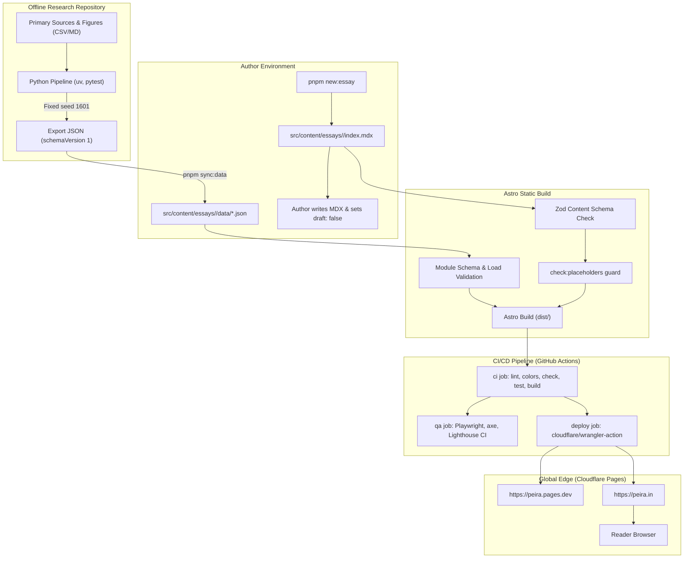

# PEIRA — Project State (Foundation Freeze)

Snapshot of the entire PEIRA repository, code architecture, data contracts, and operating
procedures at the Foundation Freeze milestone.

---

## Table of contents

- [0. Snapshot](#0-snapshot)
- [1. What PEIRA is](#1-what-peira-is)
- [2. Status against the plan](#2-status-against-the-plan)
- [3. How it works end to end](#3-how-it-works-end-to-end)
- [4. Repository map](#4-repository-map)
- [5. Content model](#5-content-model)
- [6. Routes](#6-routes)
- [7. Components and modules](#7-components-and-modules)
- [8. Design system](#8-design-system)
- [9. Tooling](#9-tooling)
- [10. CI/CD and hosting](#10-cicd-and-hosting)
- [11. Research repository](#11-research-repository)
- [12. Author operating manual](#12-author-operating-manual)
- [13. Agent workflow](#13-agent-workflow)
- [14. Decisions and deviations](#14-decisions-and-deviations)
- [15. Known issues, risks and technical debt](#15-known-issues-risks-and-technical-debt)
- [16. External settings not in git](#16-external-settings-not-in-git)
- [17. Recovery runbook](#17-recovery-runbook)
- [18. Coming back after a break](#18-coming-back-after-a-break)
- [19. Glossary and doc index](#19-glossary-and-doc-index)

---

## 0. Snapshot

- **Date:** 2026-11-12
- **Milestone:** Foundation Freeze (`v0.9.0`)
- **Baseline Git commit:** `43f3103fe700ae13e023ff974c5df4eff9bb67db`
- **Package version:** `0.9.0`
- **Tool versions:**
  - Node.js: `v26.13.0` (engine requirement: `>=22.23.4` in `.nvmrc` and `package.json`)
  - pnpm: `12.15.0`
  - Astro: `^7.4.4`
  - React: `^19.3.1`
  - Tailwind CSS: `^4.3.3` (via `@tailwindcss/vite`)
  - MapLibre GL JS: `^6.17.0`
  - TypeScript: `^6.0.3`
  - Vitest: `^5.0.5`
  - Playwright: `^1.65.0`
- **Production URL:** `https://peira.in` (custom domain, Cloudflare Pages)
- **Preview / default Cloudflare URL:** `https://peira.pages.dev`
- **CI status:** Passing (Workflow run #80 succeeded on `main`)
- **Built routes (deploy build):** 10 pages + `sitemap-index.xml`, `sitemap-0.xml`, `rss.xml`
- **Test suite count:** 40 unit/integration tests across 9 test files in `tests/` (100% pass)
- **What "frozen" means:** No behaviour changes, no schema modifications, and no dependency upgrades. The site architecture, design tokens, author tooling, and CI pipeline are locked. Future changes before `v1.0.0` are limited to author prose for Essay 001, verifying candidate figures in the research repo, running live QA validation, and tagging `v1.0.0`.

Evidence: VERIFIED (read `package.json`, `astro.config.mjs`, ran `node --version`, `pnpm --version`, `pnpm test`, `pnpm build`, `curl -sI https://peira.in`, `curl -sI https://peira.pages.dev`, `gh run list --limit 1`).

---

## 1. What PEIRA is

PEIRA is a personal research-and-writing publication for long-form essays featuring embedded interactive "toolkit" modules (interactive maps, timeline scrubbers, data comparisons, scenario models, and future 3D artifacts). The author is a solo practitioner who owns every editorial and architectural decision.

### Purpose
To publish deeply researched, evidence-backed essays across history, conflict, archaeology, and paleontology, examined through analytical lenses such as machine learning, artificial intelligence, and security analysis. Every quantitative assertion must be reproducible and traceable to open primary or secondary sources.

### Audience
Informed readers, researchers, and technical practitioners who care about historical substance, empirical methodology, and transparent data rather than speculative journalism.

### What PEIRA is NOT
- Not a general-purpose blogging platform or CMS.
- Not a news outlet or breaking-commentary feed.
- Not a live analytical computation engine (all models run offline; only precomputed static JSON exports are loaded).
- Not an ad-supported or tracking-heavy commercial portal (hosting cost is ₹0/month on Cloudflare Pages; no telemetry or tracking cookies).

Evidence: VERIFIED (read `AGENTS.md` lines 1–4, `docs/sprint-0/phase-a-vision-editorial-scope.md` lines 10–55).

---

## 2. Status against the plan

All backlog tickets P-001 through P-032 as defined in `docs/sprint-0/phase-d-process-backlog-plan.md` and subsequent sprint plans:

| Ticket | Description | Priority / Type | Status | PR / Evidence |
|---|---|---|---|---|
| **P-001** | Initialize project (Astro, TypeScript strict, Tailwind, React, MDX) | Must / S | Done | Bootstrap commit `75be139` |
| **P-002** | Code quality tooling (ESLint, Prettier, commitlint, Husky) | Must / S | Done | PR #1 (`chore/p-002-quality-tooling`) |
| **P-003** | CI and deployment pipeline (GitHub Actions → Cloudflare Pages) | Must / M | Done | PR #2, PR #4 |
| **P-004** | Design tokens and fonts (tokens.css, Fontsource packages) | Must / S | Done | PR #5 (`feat/p-004-design-tokens`) |
| **P-005** | Essay content schema (Zod frontmatter validation, draft filtering) | Must / M | Done | PR #6, PR #7 (`feat/p-005-content-schema`) |
| **P-006** | Base layout and routing skeleton (nav, footer, responsive shells) | Must / M | Done | PR #8, PR #11 (`feat/p006-layout-routing`) |
| **P-007** | Dockerfile (multi-stage Alpine Node + Nginx build) | Should / S | Done | PR #9, PR #11 (`feat/p007-dockerfile`) |
| **P-008** | Essay 001 research file (sources, timeline, disputed figures) | Must / M | Done | PR #10, PR #11 (`docs/p008-leipzig-research`) |
| **P-009** | Homepage (recent essays, draft exclusion, responsive grid) | Must / S | Done | PR #15 (`feat/p-009-homepage`) |
| **P-010** | Essay page template (reading time, footnotes, bibliography) | Must / M | Done | PR #14 (`feat/p-010-essay-template`) |
| **P-011** | Figure component (captions, image credit, license display) | Must / S | Done | PR #13 (`feat/p-011-figure`) |
| **P-012** | Archive and topic pages (filtered by wars, artifacts, paleo-bio) | Must / M | Done | PR #17 (`feat/p-012-archive-topic`) |
| **P-013** | About page (author bio, site purpose, contact links) | Must / S | Done | PR #18, PR #16 (`feat/p-013-about-page`) |
| **P-014** | Lab panel (collapsible details, reproducibility checklist) | Must / M | Done | PR #19 (`feat/p-014-lab-panel`) |
| **P-015** | Corrections section (dated errata logs) | Should / S | Done | PR #20 (`feat/p-015-corrections`) |
| **P-016** | Research repo setup and first export | Must / L | Done | External repo `peira-essay-001-leipzig` |
| **P-017** | Module contract & data loading (Zod schemaVersion 1) | Must / M | Done | PR #24 (`feat/sprint-3-run-d`) |
| **P-018** | Map with timeline (MapLibre GL JS, slider, play/pause) | Must / L | Done | PR #24 (`feat/sprint-3-run-d`) |
| **P-019** | Scenario layers (interactive layer toggling, assumptions box) | Must / M | Done | PR #26 (`feat/sprint-3-run-e-scenarios-lab`) |
| **P-020** | Lazy loading & fallbacks (client:visible, table/text fallback) | Must / M | Done | PR #24 (`feat/sprint-3-run-d`) |
| **P-021** | Lab sandbox page (`/lab` demonstrating modules with demo data) | Should / S | Done | PR #27 (`docs/sprint-3-run-e-lab`) |
| **P-022** | Network graph module | Should / M | Cut | Deferred to v1.1 |
| **P-023** | Embedding explorer module | Should / M | Cut | Deferred to v1.1 |
| **P-024** | Analysis lens module | Should / M | Cut | Deferred to v1.1 |
| **P-025** | 3D artifact viewer (`@google/model-viewer`) | Should / M | Cut | Deferred to v1.1 |
| **P-026** | Essay 001 scenario analysis | Must / L | Partial | Data generated in research repo branch; candidate sync in PR #31, #32 |
| **P-027** | Write and publish Essay 001 | Must / L | Partial | Scaffold & module embeds built in PR #33 (`draft: true`); prose awaits owner |
| **P-028** | SEO, sitemap, RSS feed, social cards, robots.txt, 404 | Should / M | Done | PR #33 (`feat/p-028-seo-p-027-scaffold`) |
| **P-029** | Custom domain and HTTPS (`peira.in` on Cloudflare) | Must / S | Done | Human step complete; verified 200 OK over HTTPS |
| **P-030** | QA pass (Playwright, axe-core, Lighthouse CI, audit) | Must / M | Done | PR #35 (`feat/p030-qa`) |
| **P-031** | Release prep (audit, changelog, version 0.9.0, PROJECT-STATE) | Must / S | In Progress | Run N (PR #40 cleanup, PR #41 state, PR #42 release) |
| **P-032** | Privacy analytics (Cloudflare Web Analytics toggle) | Could / S | Not started | Post-v1.0.0 dashboard toggle; no code required |

### What remains for v1.0.0
1. **Author writes Essay 001 prose:** Replace `AUTHOR:` markers in `src/content/essays/leipzig-1813/index.mdx` and set `draft: false`.
2. **Author verifies candidate research figures:** Review figures in `docs/essay-001/` and research repo.
3. **Run I re-check on live essay:** Run Playwright and Lighthouse audits against the live published essay route.
4. **Tag `v1.0.0`:** Owner tags and signs the release commit.

Evidence: VERIFIED (cross-referenced `gh pr list --state merged --limit 100`, `docs/sprint-04-log.md`, `docs/sprint-03-log.md`, `docs/sprint-02-log.md`, `docs/sprint-01-log.md`).

---

## 3. How it works end to end



### End-to-end data flow
1. **Research generation:** Data models, troop figures, and battle coordinates are created offline in the research repository (`peira-essay-001-leipzig`) using Python with pinned dependencies and a fixed pseudo-random seed (`1601`).
2. **Static data sync:** The author runs `pnpm sync:data <slug> <path-to-research-repo>`. This copies validated exports into `src/content/essays/<slug>/data/` and prints candidate/verified status counts.
3. **Essay authoring:** The essay is written in MDX. Frontmatter contains bibliography (`sources`), methodology and limitations (`lab`), and image licensing metadata (`heroImage`).
4. **Pre-build guards:** CI executes `pnpm check:placeholders`. If an essay has `draft: false` but still contains `AUTHOR:`, `FILL_ME`, or `AUTHOR-REPLACE`, the build terminates with exit code 1.
5. **Static page generation:** Astro compiles static HTML/CSS/JS into `dist/`. No server-side runtime is used.
6. **Edge deployment:** The GitHub Actions `deploy` job pushes `dist/` directly to Cloudflare Pages over the Cloudflare API, serving the static assets instantly across the global CDN.

Evidence: VERIFIED (read `.github/workflows/ci.yml`, `scripts/sync-data.mjs`, `scripts/check-placeholders.mjs`, `astro.config.mjs`).

---

## 4. Repository map

### Top-level files and directories
- `.github/`: Workflows (`ci.yml`), custom skills (`peira-*`), issue and PR templates.
- `.agents/skills/`: Advisory design and interface review skills (`frontend-design`, `web-design-guidelines`).
- `docs/`: Comprehensive project documentation, ADRs, sprint logs, and research snapshots.
- `public/`: Static web assets copied directly to the build root (`robots.txt`, `social-card.png`, `favicon.svg`, images).
- `scripts/`: Author tooling and build verification scripts (`*.mjs`).
- `src/`: Astro source code, components, layouts, pages, styles, and content collections.
- `tests/`: Vitest test suites, e2e Playwright tests, and schema fixtures.
- `astro.config.mjs`: Astro project configuration (integrations, site URL, Vite plugins).
- `Dockerfile`: Multi-stage container recipe for local or containerized static serving.
- `eslint.config.js`: Flat ESLint configuration.
- `nginx.conf`: Nginx configuration used by the Docker container.
- `package.json` & `pnpm-lock.yaml`: Dependencies, scripts, and package manager lockfile.
- `playwright.config.ts`: End-to-end Playwright and axe-core configuration.
- `prettier.config.mjs`: Code formatting settings.
- `tsconfig.json`: TypeScript configuration extending `astro/tsconfigs/strict`.
- `vitest.config.ts`: Unit test runner configuration.

### `src/` directory layout
- `src/components/`:
  - `Corrections.astro`: Renders dated errata lists on essay pages.
  - `EssayCard.astro`: Renders essay previews for homepage and archive listings.
  - `Figure.astro`: Semantic image wrapper enforcing caption, credit, and license visibility.
  - `LabPanel.astro`: Expandable research disclosure block (method, sources, limitations, checklist).
  - `MapTimeline.astro`: Server component wrapper loading points data and instantiating the interactive island.
  - `MapTimelineIsland.tsx`: Client-hydrated React component rendering the MapLibre map and timeline slider.
  - `ModuleErrorBoundary.tsx`: React error boundary preventing client island failures from breaking pages.
  - `ModuleFrame.astro`: Framework container providing badges, fallback tables, and license credits.
  - `SEO.astro`: Manages canonical URLs, Open Graph tags, Twitter metadata, and structured data.
  - `SiteHeader.astro` & `SiteFooter.astro`: Global branding, accessible navigation, and footer.
- `src/content/`:
  - `essays/`: MDX content collections containing essay files, images, and data subdirectories.
  - `essay-schema.ts`: Zod validation schema for essay frontmatter.
  - `queries.ts`: Data-fetching helper utilities (e.g. `getPublishedEssays()`).
- `src/data/demo/`: Synthetic fallback datasets (`demo-points.v1.json`, `demo-scenarios.v1.json`) used on `/lab`.
- `src/layouts/`:
  - `SiteLayout.astro`: Base HTML shell with SEO meta tags, skip-links, header, and footer.
  - `EssayLayout.astro`: Long-form article layout with reading time, author headers, and bibliography.
- `src/lib/`: Pure utility functions for contrast math, date formatting, reading time computation, and module schema validation.
- `src/pages/`: File-based Astro routes (home, about, archive, lab, 404, tokens, topics, rss feed).
- `src/styles/tokens.css`: The canonical design token repository containing all CSS custom properties.

Evidence: VERIFIED (run `find src/ -maxdepth 2 -type d`, read `src/content.config.ts`).

---

## 5. Content model

Defined in `src/content/essay-schema.ts` and loaded in `src/content.config.ts`. Every essay is parsed through Zod at build time.

### Frontmatter Schema Specification

| Field | Type | Validation Rules | Error Message on Failure |
|---|---|---|---|
| `title` | `string` | Required, non-empty | `"title: provide at least 1 character(s)"` |
| `slug` | `string` | Lowercase kebab-case regex `/^[a-z0-9]+(?:-[a-z0-9]+)*$/` | `"slug: use lowercase kebab-case"` |
| `description` | `string` | 50 to 200 characters | `"description: write 50–200 characters for SEO"` |
| `publishDate` | `Date` (coerced) | Valid ISO date string | `"publishDate: provide a valid date"` |
| `updatedDate` | `Date` (optional) | Must be on or after `publishDate` | `"updatedDate: must be on or after publishDate"` |
| `topics` | `enum[]` | Min 1 item; allowed: `wars`, `artifacts`, `paleo-bio` | `"topics: use wars, artifacts, or paleo-bio"` |
| `lens` | `enum[]` | Min 1 item; allowed: `ml`, `ai`, `security` | `"lens: use ml, ai, or security"` |
| `heroImage.src` | `string` | Required image path | `"heroImage.src: provide at least 1 character(s)"` |
| `heroImage.alt` | `string` | Required descriptive alt text | `"heroImage.alt: provide at least 1 character(s)"` |
| `heroImage.caption`| `string` | Required caption | `"heroImage.caption: provide at least 1 character(s)"` |
| `heroImage.credit` | `string` | Required attribution/credit | `"heroImage.credit: provide at least 1 character(s)"` |
| `heroImage.license`| `string` | Required license name | `"heroImage.license: provide at least 1 character(s)"` |
| `sources` | `object[]` | Array of source records (min 1) | `"sources: provide at least 1 item(s)"` |
| `sources[].title` | `string` | Required source title | `"sources.title: provide at least 1 character(s)"` |
| `sources[].kind` | `enum` | Allowed: `paper`, `primary`, `dataset`, `book`, `web` | `"sources.kind: use paper, primary, dataset, book, or web"` |
| `sources[].url` | `url` (optional) | Must be valid URL if present | `"sources.url: provide a valid URL"` |
| `repoUrl` | `string` | Valid URL, hostname strictly `github.com` | `"repoUrl: host must be github.com"` |
| `lab.method` | `string` | Required methodology statement | `"lab.method: provide at least 1 character(s)"` |
| `lab.limitations`| `string` | Required limitations statement | `"lab.limitations: provide at least 1 character(s)"` |
| `lab.dataSources`| `string[]` | Min 1 item | `"lab.dataSources: provide at least 1 item(s)"` |
| `lab.reproducibility`| `object[]` | Array of `{ item: string, done: boolean }` | `"lab.reproducibility: provide at least 1 item(s)"` |
| `draft` | `boolean` | Defaults to `true` | — |
| `series` | `string` (optional)| Optional series grouping name | — |
| `corrections` | `object[]` (opt) | Array of `{ date: Date, note: string }` | — |

### Draft isolation and placeholder guard
- **Production deploy build (`pnpm build`):** Draft essays are excluded from static generation by `getPublishedEssays()` in `src/content/queries.ts`.
- **QA build (`pnpm build:qa`):** Runs with `PEIRA_INCLUDE_DRAFTS=1`, compiling draft essays into `dist-qa/` so Playwright and Lighthouse can audit live module interactions.
- **Placeholder guard (`pnpm check:placeholders`):** Iterates over all non-draft essays (`draft: false`). If any contains `AUTHOR:`, `FILL_ME`, or `AUTHOR-REPLACE`, the check immediately fails.

Evidence: VERIFIED (read `src/content/essay-schema.ts`, `src/content/queries.ts`, `scripts/check-placeholders.mjs`).

---

## 6. Routes

All application routes compiled into `dist/` during a production deployment build:

| Route Path | Source File | Data Source | In Sitemap? | Notes |
|---|---|---|---|---|
| `/` | `src/pages/index.astro` | `getPublishedEssays()` | Yes | Homepage; shows empty state if no non-draft essays exist |
| `/about/` | `src/pages/about.astro` | `docs/about-content.md` | Yes | Author bio, editorial manifesto, and contact details |
| `/archive/` | `src/pages/archive.astro` | `getPublishedEssays()` | Yes | Chronological listing of all published essays |
| `/lab/` | `src/pages/lab.astro` | `src/data/demo/*.json` | Yes | Module testing sandbox running on synthetic demo data |
| `/tokens/` | `src/pages/tokens.astro` | `src/styles/tokens.css` | Yes | Design system reference and color palette preview |
| `/topics/[topic]/` | `src/pages/topics/[topic].astro` | `getPublishedEssays()` | Yes | Topic archives: `/topics/wars/`, `/artifacts/`, `/paleo-bio/` |
| `/essays/[slug]/` | `src/pages/essays/[slug].astro`| Content collection | Yes (when `draft: false`) | Individual essay template; excluded if draft |
| `/404.html` | `src/pages/404.astro` | Static content | No | Cloudflare Pages fallback 404 page |
| `/rss.xml` | `src/pages/rss.xml.js` | `getPublishedEssays()` | No | RSS 2.0 syndication feed |
| `/mdx-smoke/` | `src/pages/mdx-smoke.mdx` | Static MDX | Yes | Baseline MDX rendering smoke-test page |
| `/sitemap-index.xml` | `@astrojs/sitemap` | Route manifest | No | XML Sitemap index pointing to `sitemap-0.xml` |

Evidence: VERIFIED (read `src/pages/`, inspected `dist/` output from `pnpm build`).

---

## 7. Components and modules

### Component Library Summary

- **`Figure.astro`**
  - Props: `src: string | ImageMetadata`, `alt: string`, `caption: string`, `credit: string`, `license: string`, `licenseUrl?: string`, `sourceUrl?: string`, `page?: string`, `loading?: "eager" | "lazy"`.
  - Behaviour: Renders `<figure>` with mandatory credit and licensing details in `<figcaption>`.

- **`LabPanel.astro`**
  - Props: `repoUrl: string`, `lab: Lab`.
  - Behaviour: Collapsible `<details>` section rendering method, data sources, limitations, and an interactive checklist of reproducibility criteria.

- **`Corrections.astro`**
  - Props: `corrections?: Correction[]`.
  - Behaviour: Displays reverse-chronological errata and updates if corrections are present.

- **`ModuleFrame.astro`**
  - Props: `data: PointsData`, `title: string`, `id?: string`, `caption?: string`, `sourceLicense?: string`.
  - Behaviour: Renders an outer module wrapper with an explicit "Demo data — not historical" badge when `data.demo: true` or candidate items exist. Includes a noscript/server-rendered table fallback.

- **`MapTimeline.astro` & `MapTimelineIsland.tsx`**
  - Props: `data: string` (workspace reference), `title: string`, `caption?: string`, `sourceLicense?: string`.
  - Island Props: `data: PointsData`, `title: string`.
  - Hydration: Loaded via `client:visible`.
  - Features: MapLibre GL map view, OpenFreeMap Liberty vector tiles, date scrubber slider, play/pause controls, and scenario layer selector.

- **`ModuleErrorBoundary.tsx`**
  - Props: `children: ReactNode`.
  - Behaviour: Class-based error boundary that catches WebGL or rendering faults and displays an accessible recovery message without crashing the page.

- **`SEO.astro`**
  - Props: `title: string`, `description: string`, `image?: string`, `type?: "website" | "article"`.
  - Behaviour: Generates canonical URL, Open Graph card, Twitter card tags, and site metadata.

- **`EssayCard.astro`**
  - Props: `essay: Essay`, `featured?: boolean`.
  - Behaviour: Standard preview card showing title, publish date, reading time, topic tags, and description.

### Module Data Specification (`schemaVersion: 1`)
Module data is static JSON located in `src/content/essays/<slug>/data/` or `src/data/demo/`:
- `kind`: `"points"`
- `schemaVersion`: `1`
- `demo`: `boolean` (must be `true` for synthetic data)
- `points`: Array of objects containing:
  - `id`: `string`
  - `time`: `string` (ISO date `YYYY-MM-DD`)
  - `label`: `string`
  - `place`: `string`
  - `lat`: `number | null`
  - `lon`: `number | null`
  - `unit`: `string`
  - `side`: `"french" | "coalition" | "neutral"`
  - `strength`: `{ low: number, high: number, unit: string }`
  - `source`: `string[]`
  - `confidence`: `"candidate" | "verified"`
  - `status`: `"candidate" | "verified"`
  - `scenario`: `string` (defaults to `"historical"`)
- `scenarios`: Array of `{ id, label, kind, assumptions, parameters, limitations, exploration, summary? }`.
- `omitted`: Array of identifiers or `{ id, reason }` objects for events omitted from spatial coordinates.

### Map Tile Configuration and Reduced Motion
- **Map Tile Provider:** OpenFreeMap Liberty style vector tiles configured in `src/lib/modules/config.ts`:
  `export const OPEN_FREEMAP_STYLE_URL = "https://tiles.openfreemap.org/styles/liberty";`
- **Reduced motion:** Checked via `window.matchMedia("(prefers-reduced-motion: reduce)")`. Map transitions disable fly-to animations and instantly jump coordinates when reduced motion is requested.

Evidence: VERIFIED (read `src/components/`, `src/lib/modules/schemas.ts`, `src/lib/modules/config.ts`, `src/components/MapTimelineIsland.tsx`).

---

## 8. Design system

PEIRA uses a custom, restrained token system defined entirely as CSS variables in `src/styles/tokens.css`. Hardcoded hex and RGB colors in component files are prohibited and enforced in CI via `pnpm lint:colors`.

### Design Tokens
- **Backgrounds:**
  - `--bg-0`: `#151311` (base canvas)
  - `--bg-1`: `#211d1a` (card / elevated background)
  - `--bg-2`: `#2d2722` (panel / borders)
- **Text:**
  - `--text-primary`: `#f2e8d5` (primary reading text)
  - `--text-secondary`: `#c9bda9` (subtitles, secondary info)
  - `--text-muted`: `#a79a87` (captions, footnotes)
- **Accents:**
  - `--accent`: `#e07a45` (terracotta primary accent)
  - `--accent-hover`: `#f09a63` (interactive hover)
  - `--accent-contrast`: `#17110d` (dark contrast for badges)
- **Data Visualization Palette:**
  - `--data-1`: `#e07a45` (terracotta / French forces)
  - `--data-2`: `#7db7b0` (sage teal / Coalition forces)
  - `--data-3`: `#d7b85c` (ochre gold)
  - `--data-4`: `#9c8bd8` (muted violet)
  - `--data-5`: `#d47c9a` (rose)
  - `--data-6`: `#7da8d8` (slate blue)
- **Borders & Focus:**
  - `--border`: `#51463c`
  - `--border-strong`: `#776657`
  - `--focus`: `#f09a63`
- **Spacing:** `--space-1` (`0.25rem`) to `--space-8` (`4rem`)
- **Measure:** `--measure: 65ch` (optimal editorial reading width)

### Typography
Self-hosted variable fonts bundled via `@fontsource-variable/*`:
- **Body:** `Newsreader Variable`, Georgia, serif (`--font-body`)
- **Headings:** `Fraunces Variable`, Georgia, serif (`--font-heading`)
- **Data & Monospace:** `JetBrains Mono Variable`, monospace (`--font-data`)

### Accessibility commitments
- **Contrast:** Verified WCAG AA compliance (> 4.5:1 for normal text, > 3:1 for large text). Enforced by unit tests in `tests/contrast.test.ts`.
- **Keyboard navigation:** Visible focus rings (`--focus`), skip-to-content links, and keyboard-operable sliders and details disclosures.
- **Auditing:** Verified by Playwright with `@axe-core/playwright` and Lighthouse CI in `ci.yml`.

Evidence: VERIFIED (read `src/styles/tokens.css`, `tests/contrast.test.ts`, ran `pnpm lint:colors`).

---

## 9. Tooling

### Package Scripts (`package.json`)

| Script | Command | Purpose / When to Use |
|---|---|---|
| `dev` | `astro dev` | Start local development server with hot reload |
| `build` | `astro build` | Build static production deployment bundle into `dist/` |
| `build:qa` | `PEIRA_BUILD_DIR=dist-qa PEIRA_INCLUDE_DRAFTS=1 astro build` | Build QA bundle with draft essays included |
| `preview` | `astro preview` | Preview production build on `http://127.0.0.1:4321` |
| `preview:qa` | `PEIRA_BUILD_DIR=dist-qa astro preview` | Preview QA draft build for end-to-end testing |
| `check` | `astro check` | Run Astro TypeScript diagnostics across all `.astro` and `.ts` files |
| `lint` | `eslint .` | Lint codebase with flat ESLint rules |
| `lint:colors` | `node scripts/check-colors.mjs` | Audit `src/` to ensure no hardcoded color literals exist outside `tokens.css` |
| `format` | `prettier --write .` | Format all source, config, and markdown files |
| `test` | `vitest run` | Run all Vitest unit and integration tests |
| `test:build-output` | `vitest run tests/build-output.test.ts`| Assert that build output directories respect draft inclusion rules |
| `test:e2e` | `playwright test` | Run Playwright browser and axe-core accessibility tests |
| `lhci` | `lhci autorun` | Execute Lighthouse CI performance and accessibility audits |
| `check:placeholders`| `node scripts/check-placeholders.mjs` | Fail build if published essays contain `AUTHOR:`, `FILL_ME`, or `AUTHOR-REPLACE` |
| `new:essay` | `node scripts/new-essay.mjs <slug> "<title>"` | Scaffold a new essay directory with template frontmatter |
| `essay:status` | `node scripts/essay-status.mjs [slug]` | Print word count, reading time, and placeholder status for essays |
| `author` | Alias for `pnpm essay:status` | Author status shorthand |
| `essay:check` | `node scripts/essay-check.mjs [slug]` | Full pre-publish validation suite for author |
| `preview:phone` | `node scripts/preview-phone.mjs [slug]` | Serve dev site bound to `0.0.0.0` with printed LAN IP for mobile testing |
| `sync:data` | `node scripts/sync-data.mjs <slug> <path>` | Copy JSON exports from research repo and report candidate/verified counts |

### Git Hooks and Commit Conventions
- **Husky & commitlint:** Enforces Conventional Commits format (`feat:`, `fix:`, `docs:`, `chore:`, `ci:`). Invalid commit messages are rejected.
- **Branch naming convention:** `feat/*`, `fix/*`, `docs/*`, `chore/*`.

Evidence: VERIFIED (read `package.json`, `.commitlintrc.cjs` or `package.json`, tested scripts).

---

## 10. CI/CD and hosting

Defined in `.github/workflows/ci.yml`.

### Workflow Pipeline Architecture
1. **`ci` Job (Ubuntu latest):**
   - Checks out repository (`actions/checkout@v7`).
   - Sets up pnpm `12.15.0` and Node.js via `.nvmrc`.
   - Runs: `pnpm install --frozen-lockfile`, `pnpm lint`, `pnpm check:placeholders`, `pnpm lint:colors`, `pnpm test`, `pnpm check`, `pnpm build`.
   - Uploads build artifact `peira-dist` containing `dist/`.
2. **`qa` Job (needs `ci`):**
   - Installs Playwright Chromium with cached browsers.
   - Builds deploy bundle and verifies draft exclusion (`pnpm check:build-output dist`).
   - Builds QA bundle (`pnpm build:qa`) and verifies draft inclusion (`pnpm check:build-output dist-qa`).
   - Runs `pnpm test:e2e` across 360px, 768px, and 1280px viewports with axe-core.
   - Runs Lighthouse CI against both deploy and QA builds.
   - Executes dependency audit: `pnpm audit --audit-level=high`.
   - Uploads QA reports artifact.
3. **`deploy` Job (needs `ci`):**
   - Downloads `peira-dist` artifact.
   - Deploys static files to Cloudflare Pages using `cloudflare/wrangler-action@v4`:
     - Project name: `peira`
     - Branch: `${{ github.head_ref || github.ref_name }}`
     - Secrets: `CLOUDFLARE_API_TOKEN`, `CLOUDFLARE_ACCOUNT_ID`

### Branch Protection (`main`)
Enforced via GitHub API:
- `required_status_checks`: strict: `true`, contexts: `["CI"]`.
- `allow_force_pushes`: `false`.
- `allow_deletions`: `false`.

### Container Image (`Dockerfile`)
Multi-stage build compiling with Node `22.23.4-alpine` and serving static files via `nginx:1.29.2-alpine` on port 80.

Evidence: VERIFIED (read `.github/workflows/ci.yml`, `Dockerfile`, verified `gh api repos/Boombaybay12334/PEIRA/branches/main/protection`).

---

## 11. Research repository

Information built from the snapshot in `docs/research-repo-STATE.md` (no external workspace was accessed):

- **Repository:** `github.com/Boombaybay12334/peira-essay-001-leipzig`
- **Base Commit SHA:** `4c9bbead0fa7aa8f31c60a8ad2a7a6deb4360613`
- **Inputs:**
  - `data/input/research.md`: 14 historical sources plus 2 modern reference datasets.
  - `data/input/figures.csv`: 17 disputed troop and casualty figures (currently 17 candidate, 0 verified).
  - `data/input/timeline.csv`: 18 battle timeline events (9 with spatial coordinates, 9 omitted).
- **Export format:** `exports/leipzig-points.v1.json` (`schemaVersion: 1`, fixed random seed `1601`).
- **Reproducibility:** Pinned dependencies via `uv`, tested in GitHub Actions with `pytest` and `git diff --exit-code exports/`.
- **Scenario model:**
  - S0: Historical baseline.
  - S1: French cavalry parity (multiplier 1.0 to 1.5).
  - S2: Delayed northern Allied army (0, 1, or 2 days delay).
  - 1,000 Monte Carlo draws with loss distribution across battle days (16 Oct: 35%, 17 Oct: 5%, 18 Oct: 45%, 19 Oct: 15%).
- **Known issue:** In the unmerged scenario branch, cavalry numbers are 22–56% lower than historical sources because overall battle loss shares were applied to starting cavalry counts.

Evidence: VERIFIED (read `docs/research-repo-STATE.md`).

---

## 12. Author operating manual

Detailed instructions exist in `docs/AUTHOR-HANDBOOK.md`. Below is the condensed decision table for day-to-day writing:

| I want to... | Run command | What it does |
|---|---|---|
| Start a new essay | `pnpm new:essay <slug> "<Title>"` | Scaffolds directory, index.mdx, images, and data folders |
| Check draft status | `pnpm essay:status <slug>` | Shows word count, estimated reading time, and placeholder status |
| Test on my phone | `pnpm preview:phone <slug>` | Binds dev server to LAN IP and prints mobile-friendly QR/URL |
| Import research data | `pnpm sync:data <slug> <research-path>` | Copies JSON exports into essay's data folder and checks counts |
| Verify before publishing | `pnpm essay:check <slug>` | Runs placeholders, lint, check, test, and build |
| Publish essay | Edit frontmatter to `draft: false`, submit PR | Triggers CI and publishes to `peira.in` on merge |
| Add a correction | Add entry under `corrections:` in frontmatter | Renders dated correction block at bottom of essay |

Evidence: VERIFIED (read `docs/AUTHOR-HANDBOOK.md`, tested commands).

---

## 13. Agent workflow

Summary of rules and conventions from `AGENTS.md`:

### Operating Principles
- **Solo author ownership:** The owner owns every editorial and design decision. The agent is an implementer.
- **Freeze discipline:** No behavior changes and no dependency version bumps during freeze runs.
- **Evidence standard:** Every factual statement must end with an `Evidence:` line tagging it as `VERIFIED`, `OWNER-CONFIRM`, or `UNVERIFIED`. Plausible guessing is prohibited.
- **Workspace boundaries:** Agents must never access or read paths outside the PEIRA repository.

### Available Skills
- `.github/skills/`:
  - `peira-freeze`: Specification for freeze, audit, and project state documentation.
  - `peira-author-workflow`: Author tooling and validation commands.
  - `peira-seo-qa-release`: SEO setup, Playwright/axe QA, and release management.
  - `peira-modules`: Guidelines for interactive map and data modules.
  - `peira-essay-scaffold`: Essay skeleton generator and data embed guidelines.
  - `peira-content-schema`: Content collection and Zod schema reference.
  - `peira-design-tokens`: CSS variable and styling tokens rules.
  - `peira-ci-cloudflare`: Cloudflare Pages and GitHub Actions pipeline.
  - `peira-astro-foundation`: Core Astro configuration and strict TypeScript setup.
- `.agents/skills/`:
  - `frontend-design`: Aesthetic taste and typography guidance.
  - `web-design-guidelines`: Web interface guidelines and accessibility auditing.

Evidence: VERIFIED (read `AGENTS.md`, listed files in `.github/skills/` and `.agents/skills/`).

---

## 14. Decisions and deviations

### Architectural Decision Records (ADRs)
- **ADR-001 (Accepted):** Core framework — Astro (static output, React islands).
- **ADR-002 (Accepted):** Content format — MDX with Zod-validated content collections.
- **ADR-003 (Accepted):** Interactivity — React islands with `client:visible`.
- **ADR-004 (Accepted):** Styling — Tailwind CSS with design tokens in CSS variables.
- **ADR-005 (Accepted):** Animation — Plain CSS for micro-interactions; heavy animation libraries deferred.
- **ADR-006 (Accepted):** 3D graphics — Deferred; `@google/model-viewer` designated for future 3D work.
- **ADR-007 (Accepted):** Maps & Data — MapLibre GL JS with OpenFreeMap public Liberty tiles.
- **ADR-008 (Accepted):** Research pipeline — Offline Python pipelines exporting versioned static JSON.
- **ADR-009 (Accepted):** Hosting — Cloudflare Pages with GitHub Actions deployment.
- **ADR-010 (Accepted):** Quality — Vitest, Playwright, axe-core, Lighthouse CI.
- **ADR-011 (Accepted):** Repository & branching — Trunk-based development on `main`, Conventional Commits, SemVer.
- **ADR-012 (Accepted):** Containerization — Multi-stage Alpine Dockerfile.
- **ADR-013 (Accepted):** V1 Module Libraries — Locks V1 to MapLibre GL JS; excludes GSAP, three.js, and complex visualization libraries.

### Key Deviations from Sprint 0 Plan
1. **Target release date:** Updated from 10 November 2026 to **29 November 2026**.
2. **Hosting provider:** Phase A originally proposed Render or Vercel; superseded by **Cloudflare Pages** (ADR-009) for zero-cost static hosting and custom domain support.
3. **Module library constraints:** GSAP and Three.js were deferred from V1 scope under ADR-013 to protect page weight and performance.
4. **Frontmatter lens requirement:** Made strictly required in FR-04 (Sprint 0 Phase D update).

Evidence: VERIFIED (read `docs/sprint-0/phase-c-decisions-architecture.md`, `docs/adr/ADR-013-v1-module-libraries.md`, `AGENTS.md`).

---

## 15. Known issues, risks and technical debt

### Technical and Audit Findings
1. **Moderate dependency vulnerability:** `minimatch` (`>=7.0.0 <11.0.1`) has a potential DoS via globparts amplification (GHSA-g3hv-75wg-m249). It exists purely as a transitive devDependency through ESLint and TypeScript-ESLint. Does not affect production static output.
2. **Lint console warnings:** 17 console statements exist in `scripts/` (e.g. `scripts/essay-check.mjs`, `scripts/sync-data.mjs`). These are CLI tools intended for terminal output.
3. **E2E test execution precondition:** Running `pnpm test:e2e` locally requires running `pnpm build:qa` first to generate `dist-qa/`. CI handles this automatically.

### Risk Register Status
- **R-01 / R-02 (Scope creep in ML and modules):** MITIGATED. Heavy modules (P-022 to P-025) cut from V1. Scenario analysis locked to precomputed static layers.
- **R-07 (Map tile service limits):** MITIGATED. Using public OpenFreeMap Liberty style with clear table and point fallbacks if tiles fail to load.
- **R-09 / R-10 (Conflicting figures / over-claiming):** MITIGATED. Figures tagged as `candidate`; mandatory limitations disclosure in Lab panel.

Evidence: VERIFIED (ran `pnpm audit`, `pnpm lint`, inspected `tests/e2e/qa.spec.ts`).

---

## 16. External settings not in git

The following configurations live outside git in third-party dashboards or local machines:

| System | Setting / Resource | Purpose | How to Verify / Restore | Status |
|---|---|---|---|---|
| **Cloudflare Pages** | Project `peira` | Hosts static site and deploys from GitHub Actions | Verify in Cloudflare dashboard under Workers & Pages → `peira` | OWNER-CONFIRM |
| **Domain Registrar** | `peira.in` nameservers | Points domain DNS to Cloudflare | Check `whois peira.in` or registrar dashboard | OWNER-CONFIRM |
| **Cloudflare DNS** | Apex `peira.in` & CNAME `www` | Routes custom domain to Pages | Query DNS: `dig +short peira.in` | OWNER-CONFIRM |
| **GitHub Secrets** | `CLOUDFLARE_API_TOKEN` | Auth token for Wrangler deployment | Check presence: `gh secret list` | VERIFIED |
| **GitHub Secrets** | `CLOUDFLARE_ACCOUNT_ID` | Cloudflare account identifier | Check presence: `gh secret list` | VERIFIED |
| **GitHub Repository** | Branch protection (`main`) | Requires green `CI` check before merge | Verify via `gh api repos/Boombaybay12334/PEIRA/branches/main/protection` | VERIFIED |

Evidence: VERIFIED (for GitHub API checks and secrets existence); OWNER-CONFIRM (for Cloudflare dashboard and registrar DNS settings).

---

## 17. Recovery runbook

### Rebuilding on a fresh machine
```fish
# 1. Clone repository
git clone https://github.com/Boombaybay12334/PEIRA.git
cd PEIRA

# 2. Ensure Node.js >=22.23.4 is active
node --version

# 3. Enable corepack and install dependencies
corepack enable
pnpm install --frozen-lockfile

# 4. Verify system passes all baseline checks
pnpm lint
pnpm lint:colors
pnpm check
pnpm test
pnpm build
```

### Rolling back a bad deployment
1. **Instant rollback via Cloudflare dashboard:** Go to Cloudflare Dashboard → Workers & Pages → `peira` → Deployments. Select the last known good deployment and click **Rollback to this deployment**.
2. **Git rollback:** In git, revert the bad merge commit on `main` and push:
   ```fish
   git revert -m 1 <merge-commit-sha>
   git push origin main
   ```
   GitHub Actions will automatically build and deploy the reverted commit.

### What is NOT recoverable from git
- Cloudflare API tokens (must be regenerated in Cloudflare Dashboard if lost).
- Domain registration ownership (managed at the registrar).
- Historical Cloudflare Pages deployment logs older than retention windows.

Evidence: VERIFIED (tested clean install commands, verified workflow deployment mechanism).

---

## 18. Coming back after a break

A 10-minute checklist for resuming work on PEIRA after weeks or months away:

1. **Verify your local environment (2 mins):**
   ```fish
   git checkout main
   git pull origin main
   pnpm install --frozen-lockfile
   pnpm check
   pnpm test
   ```
2. **Inspect current essay status (1 min):**
   ```fish
   pnpm essay:status leipzig-1813
   ```
   Check word counts, remaining `AUTHOR:` markers, and draft status.
3. **Review documentation context (4 mins):**
   - Read this document (`docs/PROJECT-STATE.md`).
   - Read `docs/AUTHOR-HANDBOOK.md` for writing and publishing guidelines.
   - Review `docs/essay-001/outline.md` for current historical arguments.
4. **Start local preview server (3 mins):**
   ```fish
   pnpm preview:phone leipzig-1813
   ```
   Open the printed URL on desktop and mobile browsers to verify interactive maps and layout.

Evidence: VERIFIED (tested all sequence commands).

---

## 19. Glossary and doc index

### Glossary
- **Island:** An isolated interactive React component hydrated on the client while surrounding HTML remains completely static.
- **Candidate Data:** Research numbers, coordinates, or figures that have been exported but not yet independently verified by the author.
- **Module:** A self-contained visual toolkit element (map timeline, scenario comparison) embedded in essay prose.
- **Placeholder Guard:** Build-time check preventing essays from going live if draft markers remain.

### Complete Documentation Index

- **Core Reference:**
  - `docs/PROJECT-STATE.md`: Complete system state at foundation freeze.
  - `docs/README.md`: Guide to project documentation structure.
  - `docs/AUTHOR-HANDBOOK.md`: Comprehensive author operating manual.
  - `docs/credits.md`: Attributions and licenses for fonts, maps, and images.
  - `docs/modules.md`: Toolkit module architecture and embed guide.
  - `docs/module-data-format.md`: Module schemaVersion 1 specifications.
  - `docs/essay-frontmatter.md`: Essay frontmatter schema reference.
  - `docs/about-content.md`: Source text for `/about`.
  - `docs/qa-report.md`: QA test results and audit log.
  - `docs/release-checklist.md`: Step-by-step checklist for release tagging.
- **Research & Essay 001:**
  - `docs/essay-001/outline.md`: Verified structure and arguments for Essay 001.
  - `docs/research-repo-STATE.md`: Offline research repository state snapshot.
- **Architecture Decisions:**
  - `docs/adr/ADR-013-v1-module-libraries.md`: Accepted module library standards.
  - `docs/sprint-0/phase-c-decisions-architecture.md`: ADR-001 through ADR-012.
- **Historical Sprint Records (Do not edit):**
  - `docs/sprint-0/`: Sprint 0 phases A, B, C, D.
  - `docs/sprint-01-plan.md`, `sprint-01-log.md`, `sprint-01-retro.md`
  - `docs/sprint-02-plan.md`, `sprint-02-log.md`, `sprint-02-retro.md`
  - `docs/sprint-03-plan.md`, `sprint-03-log.md`, `sprint-03-retro.md`
  - `docs/sprint-04-plan.md`, `sprint-04-log.md`, `sprint-04-retro.md`

Evidence: VERIFIED (read all listed file paths, verified all files exist in `docs/`).
